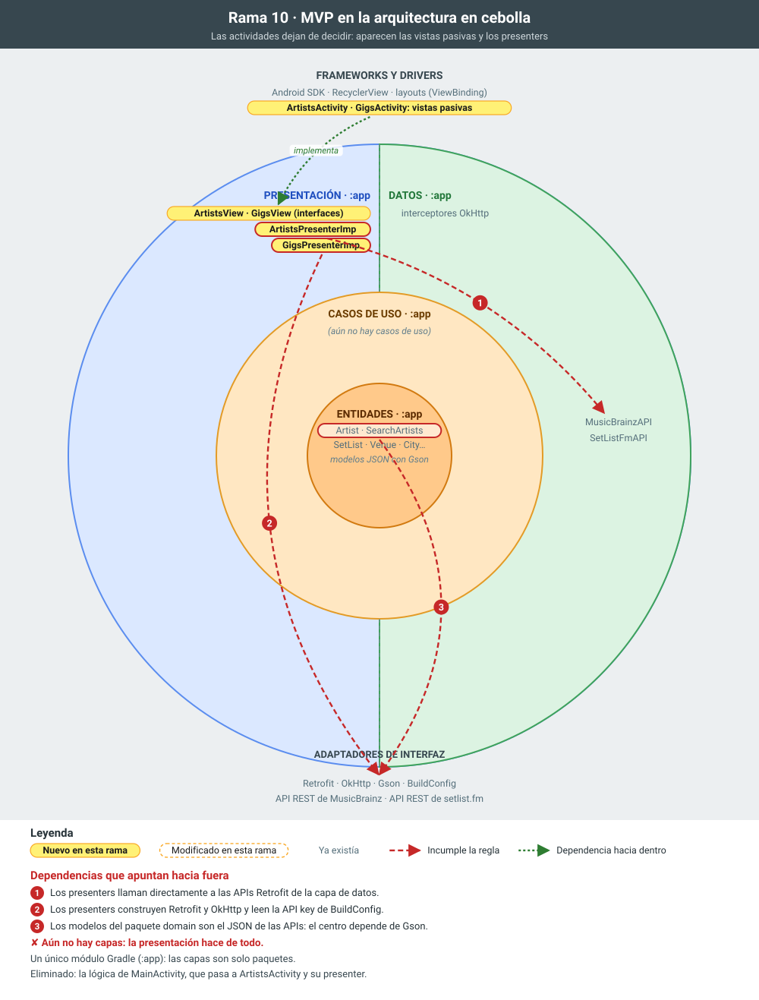

# 10 · MVP (Model-View-Presenter)

**Objetivo:** sacar de las actividades la lógica y el acceso a red. Es el primer paso de la arquitectura en capas.

## Qué cambia

- **Pantalla de artistas** (`app.presentation.artist`):
  - `ArtistsView`: la interfaz de lo que la pantalla sabe hacer (`showLoading`, `showArtists`, `showNoResults`, `showEmptyQueryError`, `navigateToGigs`…).
  - `ArtistsPresenter` / `ArtistsPresenterImp`: valida el texto, decide qué estado mostrar y hace la petición a MusicBrainz.
  - `ArtistsActivity` (antes `MainActivity`): solo pinta y reenvía los eventos del usuario al presenter.
- **Pantalla de bolos** (`app.presentation.gig`): `GigsView`, `GigsPresenter` / `GigsPresenterImp` y `GigsActivity`, con el mismo reparto.
- **`onDestroy()` del presenter.** Suelta la referencia a la vista para que una respuesta tardía no actúe sobre una actividad destruida.

## Para explicar

- **La vista es pasiva.** No toma decisiones; el presenter no conoce clases de Android de la UI, sino la interfaz `*View`.
- **El presenter se puede probar** con una vista falsa. Se hace en la feature 14.
- **Lo que sigue pendiente.** El presenter todavía conoce Retrofit y los modelos JSON. Las siguientes features lo separan en capas.

## La rama en la cebolla

En amarillo, lo que añade la rama; con borde discontinuo, lo que modifica; en gris, lo que ya existía. Las flechas rojas numeradas son dependencias que apuntan hacia fuera e incumplen la regla de dependencias; las verdes, dependencias correctas hacia dentro.

## Commits de esta rama

1. `b35a32d` Presenter y View de la pantalla de artistas
1. `cf12e1c` ArtistsActivity implementa ArtistsView
1. `b35c9db` Presenter y View de la pantalla de bolos
1. `9393d23` GigsActivity implementa GigsView
