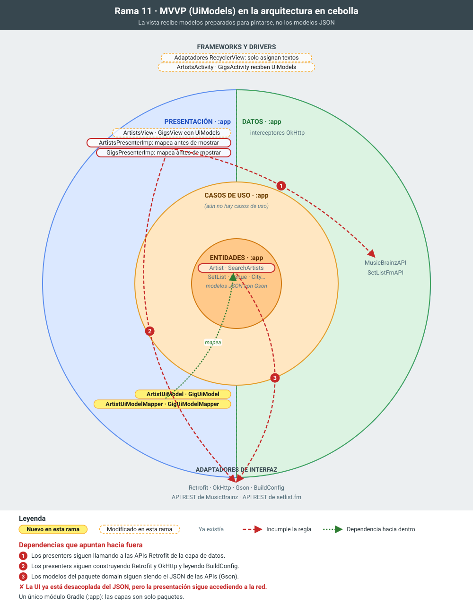

# 11 · MVVP: modelos de presentación (UiModel)

**Objetivo:** que la vista reciba objetos preparados para pintarse y no los modelos de datos.

## Qué cambia

- **Artistas.** `ArtistUiModel` (id y nombre) y `ArtistUiModelMapper`, que convierte `List<Artist>` en `List<ArtistUiModel>`.
- **Bolos.**
  - `GigUiModel` contiene solo cadenas listas para la UI: fecha formateada según el idioma del dispositivo, sala, "Ciudad, País" y gira.
  - `GigUiModelMapper` hace las comprobaciones de nulos y los formatos que antes estaban en el adaptador.
- **Presenters.** Mapean antes de llamar a la vista. Las interfaces `ArtistsView`/`GigsView` y los adaptadores pasan a trabajar con UiModels.

## Para explicar

- **La vista no decide cómo formatear.** El adaptador queda trivial (asignar textos) y el formato se puede probar sin Android.
- **Desacoplar la UI del modelo.** Si cambia el JSON o el dominio, solo cambia el mapper.
- **Por qué `UiModel` y no `ViewModel`.** Son modelos de presentación; se evita el nombre `ViewModel` para no confundirlos con el `ViewModel` de Jetpack. La arquitectura sigue siendo MVP: el nombre MVVP de la rama viene del proyecto original.

## La rama en la cebolla

En amarillo, lo que añade la rama; con borde discontinuo, lo que modifica; en gris, lo que ya existía. Las flechas rojas numeradas son dependencias que apuntan hacia fuera e incumplen la regla de dependencias; las verdes, dependencias correctas hacia dentro.

## Commits de esta rama

1. `06fc6e5` ArtistUiModel y su mapper
1. `b8581dc` La vista de artistas usa ArtistUiModel
1. `8c2678d` GigUiModel y su mapper
1. `3a8dbdf` La vista de bolos usa GigUiModel
