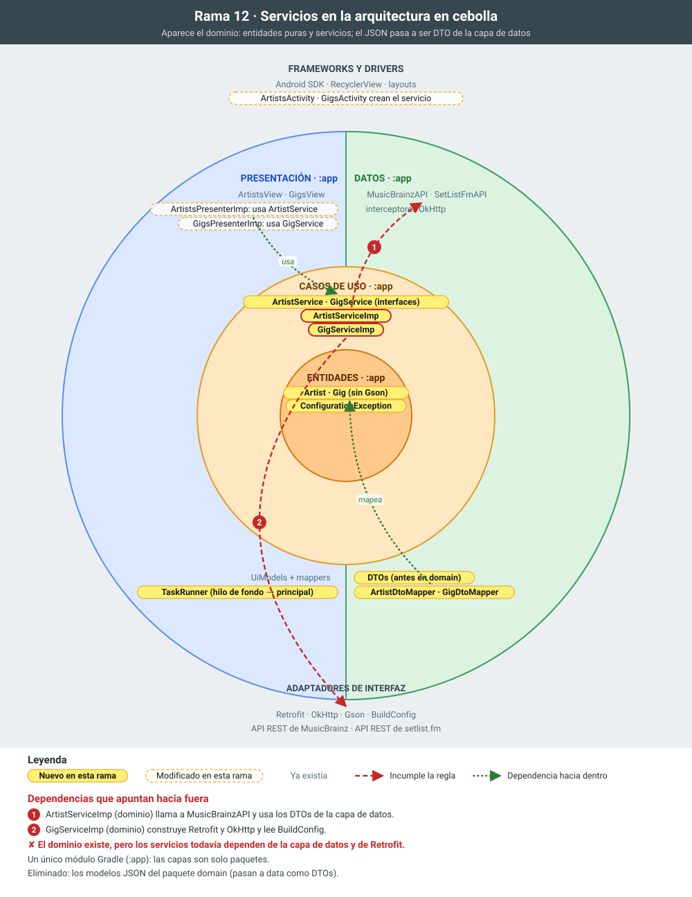

# 12 · Capa de dominio: entidades y servicios

**Objetivo:** crear la capa de dominio y que los presenters dependan de **servicios** (interfaces), no de Retrofit.

## Qué cambia

- **`TaskRunner`** (`app.executor`) ejecuta una tarea en un hilo de fondo (`ExecutorService`) y entrega el resultado en el hilo principal (`Handler`). Sustituye al `AsyncTask` del proyecto original, obsoleto desde Android 11.
- **Entidades de dominio puras:**
  - `domain.artist.Artist`;
  - `domain.gig.Gig`, plano y con la fecha como `Date`;
  - `ConfigurationException`, que indica que falta configuración, como la API key.

  No tienen anotaciones de Gson ni dependencias de Android.
- **DTOs.** Los modelos JSON pasan a la capa de datos como DTOs (`data.artist.dto`, `data.gig.dto`), con mappers DTO → dominio (`ArtistDtoMapper`, `GigDtoMapper`, que también interpreta la fecha `dd-MM-yyyy`).
- **Servicios:**
  - interfaces `ArtistService` y `GigService` en el dominio;
  - `ArtistServiceImp` y `GigServiceImp` hacen la llamada síncrona (`execute()`), ya en segundo plano gracias al `TaskRunner`.
- **Presenters.** Reciben por constructor el servicio y el `TaskRunner`.

## Para explicar

- **Regla de dependencia.** La presentación depende del dominio, y el dominio no conoce la presentación.
- **Por qué separar DTO y entidad.** El formato de una API externa no debe propagarse por toda la app.
- **Lo que sigue pendiente.** Los servicios todavía acceden a la red directamente. La feature 13 lo mueve a los *datasources*.

## La rama en la cebolla

En amarillo, lo que añade la rama; con borde discontinuo, lo que modifica; en gris, lo que ya existía. Las flechas rojas numeradas son dependencias que apuntan hacia fuera e incumplen la regla de dependencias; las verdes, dependencias correctas hacia dentro.

## Commits de esta rama

1. `13e85f7` TaskRunner: ejecución en segundo plano (sustituye a AsyncTask)
1. `801936b` Entidades de dominio Artist y Gig sin dependencias de frameworks
1. `498bc56` DTOs de la capa de datos y sus mappers al dominio
1. `1ae0299` Interfaces de servicios ArtistService y GigService
1. `5bdce44` Los presenters usan los servicios; los modelos JSON salen del dominio
