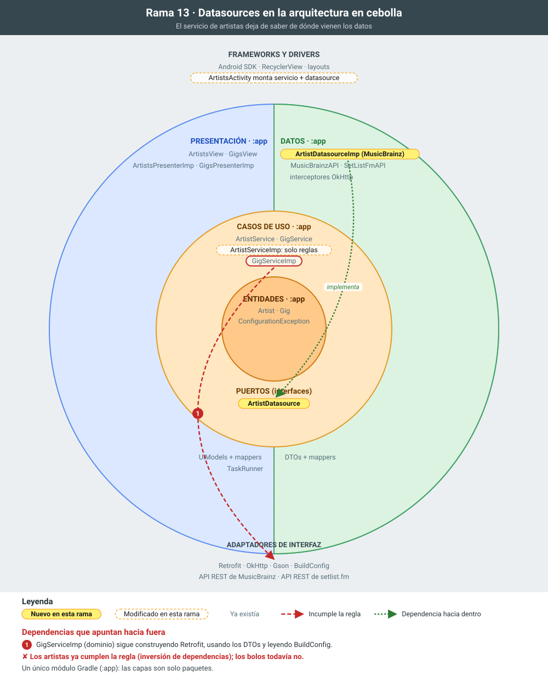

# 13 · Datasources (artistas)

**Objetivo:** que el servicio de artistas no sepa de dónde vienen los datos.

## Qué cambia

- **`ArtistDatasource`** (`domain.artist.datasource`): interfaz definida por el dominio.
- **`ArtistDatasourceImp`** (`data.artist`): implementación con Retrofit y MusicBrainz. Contiene la consulta Lucene, la gestión de errores HTTP y el mapeo de DTO a dominio.
- **`ArtistServiceImp`** recibe un `ArtistDatasource` por constructor y contiene solo la lógica de negocio: normaliza el texto y no consulta si está vacío.
- **`ArtistsActivity`** monta la cadena `ArtistServiceImp(new ArtistDatasourceImp())`.

## Para explicar

- **Inversión de dependencias.** El dominio declara la interfaz que necesita y la capa de datos la implementa. Las flechas de dependencia apuntan siempre hacia el dominio.
- **Cambiar la fuente de datos** (otra API, una caché o una base de datos local) no toca ni el servicio ni el presenter.

## La rama en la cebolla

En amarillo, lo que añade la rama; con borde discontinuo, lo que modifica; en gris, lo que ya existía. Las flechas rojas numeradas son dependencias que apuntan hacia fuera e incumplen la regla de dependencias; las verdes, dependencias correctas hacia dentro.

## Commits de esta rama

1. `96f0c93` Interfaz ArtistDatasource en el dominio
1. `a1a1a65` ArtistDatasourceImp en la capa de datos
1. `b240549` ArtistServiceImp delega en el datasource
