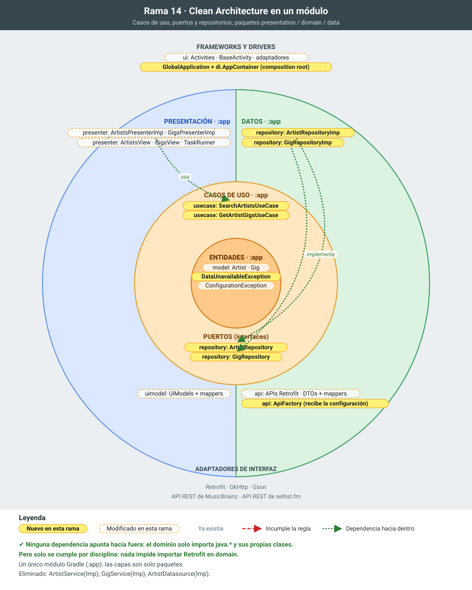

# 14 · Clean Architecture en un único módulo (paquetes por capa)

**Objetivo:** reorganizar la aplicación en las tres capas de la Clean Architecture (`presentation`, `domain` y `data`) dentro del módulo `:app`, con un paquete por capa y la regla de dependencias cumplida en todas las clases.

## Motivación

Las ramas 12 y 13 crearon un dominio, pero con dos problemas:

- **El dominio dependía de los datos.** `GigServiceImp`, dentro de `domain`, importaba Retrofit, OkHttp, los DTOs y `BuildConfig`. Es justo la dependencia que la Clean Architecture prohíbe: el centro no puede conocer los detalles técnicos.
- **Los nombres no decían qué papel tenía cada pieza.** Un "servicio" con interfaz e `Imp` mezclaba varias acciones. Un "datasource" definido en el dominio obligaba al dominio a pensar en *de dónde* salen los datos, cuando solo le interesa *qué* datos necesita.

Esta rama corrige ambas cosas sin añadir complejidad de Gradle. Todo sigue en un solo módulo, y cada carpeta corresponde a una capa del diagrama. Es la estructura de la [guía de arquitectura de Android](https://developer.android.com/topic/architecture), con el ajuste que la convierte en Clean: **las interfaces de los repositorios (los puertos) están en el dominio**.

## Estructura resultante

```
app/  (es.udc.psi.cleanarchv2.app)
├── GlobalApplication            crea el AppContainer al arrancar el proceso
├── di/
│   └── AppContainer             composition root: el único que conoce las implementaciones
├── presentation/
│   ├── ui/                      Activities, BaseActivity y adaptadores (Android)
│   ├── presenter/               Presenters, interfaces View y TaskRunner
│   └── uimodel/                 ArtistUiModel, GigUiModel y sus mappers
├── domain/                      Java puro: sin Android, sin Retrofit
│   ├── model/                   Artist, Gig
│   ├── repository/              ArtistRepository, GigRepository   ← interfaces (puertos)
│   ├── usecase/                 SearchArtistsUseCase, GetArtistGigsUseCase
│   └── exception/               DataUnavailableException, ConfigurationException
└── data/
    ├── repository/              ArtistRepositoryImp, GigRepositoryImp  ← implementan los puertos
    └── api/                     Retrofit (MusicBrainzAPI, SetListFmAPI), ApiFactory,
                                 interceptores y dto/ (DTOs + mappers DTO → entidad)
```

Las dependencias solo apuntan hacia el dominio:

```
presentation ──► domain ◄── data
```

`di.AppContainer` conoce las tres capas para crearlas y unirlas, pero ninguna capa depende de él.

## Qué cambia y por qué

1. **Entidades en `domain.model`.**
   - *Motivación:* las entidades son el núcleo y no pertenecen a ninguna funcionalidad concreta. Un paquete propio las hace visibles como el centro de la cebolla.
2. **`GlobalApplication` + `AppContainer`.**
   - *Motivación:* hasta ahora cada actividad montaba su cadena de objetos (`new ArtistServiceImp(new ArtistDatasourceImp())`). Así, la presentación conocía las implementaciones de datos.
   - Ahora Android crea la `GlobalApplication` una sola vez, antes que cualquier actividad, y esta crea el `AppContainer`. Las actividades piden ahí sus dependencias con `((GlobalApplication) getApplication()).getContainer()`.
   - Es la inyección de dependencias manual que propone la guía de Android, sin estado `static`. La `GlobalApplication` del proyecto original solo configuraba ButterKnife y se eliminó en la feature 01. Esta tiene una responsabilidad real: es el *composition root*.
3. **`data.api`: Retrofit, DTOs e interceptores en un solo paquete, y `ApiFactory`.**
   - *Motivación:* el código que construye Retrofit/OkHttp estaba copiado en `ArtistDatasourceImp` y en `GigServiceImp`. `ApiFactory` lo centraliza.
   - Además recibe la configuración como parámetros (User-Agent, API key, logging) en lugar de leer `BuildConfig`. Así la capa de datos no depende de la configuración de la app, y lo decide el `AppContainer`.
4. **Puertos, casos de uso y excepciones del dominio.**
   - `ArtistRepository` y `GigRepository` (en `domain.repository`) son lo que el dominio *necesita*. Los define él y los implementa otra capa: es la **inversión de dependencias**.
   - `SearchArtistsUseCase` y `GetArtistGigsUseCase` sustituyen a los servicios: **una clase por acción del usuario**, sin interfaz, porque son el propio dominio.
   - `DataUnavailableException` y `ConfigurationException` son excepciones del dominio. Los contratos del dominio ya no lanzan `IOException`, porque la E/S es un detalle de la capa de datos.
5. **Artistas: `ArtistRepositoryImp` implementa el puerto.**
   - Contiene lo que hacía `ArtistDatasourceImp` (consulta a MusicBrainz y mapeo DTO → entidad).
   - Traduce `IOException` a `DataUnavailableException`.
   - El presenter usa el caso de uso. Desaparecen `ArtistService` y `ArtistDatasource`.
6. **Bolos: `GigRepositoryImp` implementa el puerto.**
   - El acceso a setlist.fm sale por fin del dominio.
   - Si falta la API key lanza `ConfigurationException`, que ahora hereda de `DataUnavailableException` y no de `IOException`.
   - Desaparece `GigService`.
7. **Presentación organizada en `ui`, `presenter` y `uimodel`.**
   - *Motivación:* separar por capas también dentro de la presentación. `ui` es lo que depende de Android; `presenter` decide qué mostrar; `uimodel` prepara los datos para la vista.
   - Las interfaces `ArtistsView` y `GigsView` van con su presenter, porque el presenter las define y la `Activity` las implementa. Así las dependencias van en un único sentido: `ui → presenter → domain`.
   - `TaskRunner` pasa a `presenter`, porque solo los presenters lo usan.
8. **Tests unitarios en la JVM**, sin emulador:
   - casos de uso con repositorios falsos (lambdas);
   - presenters con vistas falsas y un `TaskRunner` síncrono;
   - `GigDtoMapper` y `GigUiModelMapper`.

## Para explicar

- **La regla de dependencias se puede comprobar con los `import`.** Ninguna clase de `domain` importa nada de `presentation`, `data`, Android ni Retrofit:
  ```bash
  grep -rh "^import" app/src/main/java/es/udc/psi/cleanarchv2/app/domain | sort -u
  ```
- **Solo se cumple por disciplina.** Nada impide escribir `import retrofit2.Call;` en una clase del dominio: compilaría. La rama 16 convierte esta convención en un error de compilación con módulos Gradle.
- **Repositorio frente a datasource.** El dominio pide "artistas" a un repositorio, no a "MusicBrainz". En esta rama el repositorio habla directamente con la API, porque solo hay una fuente. En la rama 15 aparecen dos fuentes (remota y local), y el repositorio pasa a decidir cuál usar.
- **Cada frontera traduce sus modelos:** JSON → DTO (`data.api.dto`) → entidad (`domain.model`) → UiModel (`presentation.uimodel`).

## Cómo probarlo

- Tests: `./gradlew testDebugUnitTest`.
- La app funciona igual que en la rama 13: busca un artista, pulsa sobre él y aparecen sus conciertos.

## La rama en la cebolla



En amarillo, lo que añade la rama; con borde discontinuo, lo que modifica; en gris, lo que ya existía. Las flechas rojas numeradas son dependencias que apuntan hacia fuera e incumplen la regla de dependencias; las verdes, dependencias correctas hacia dentro.

## Commits de esta rama

1. `7cc13f7` Entidades del dominio en domain.model
1. `35e0cf9` GlobalApplication y AppContainer: las dependencias se crean en un único sitio
1. `ed860fd` Clientes HTTP, DTOs e interceptores en data.api; ApiFactory recibe la configuración
1. `3e6682a` Puertos del dominio (repositorios), casos de uso y excepción propia, con sus tests
1. `19c571a` Artistas: ArtistRepositoryImp implementa el puerto y el presenter usa SearchArtistsUseCase
1. `67845ed` Bolos: GigRepositoryImp implementa el puerto y el presenter usa GetArtistGigsUseCase
1. `333c38d` Presentación organizada en ui, presenter y uimodel
1. `3ec9313` Tests unitarios de presenters y mappers
