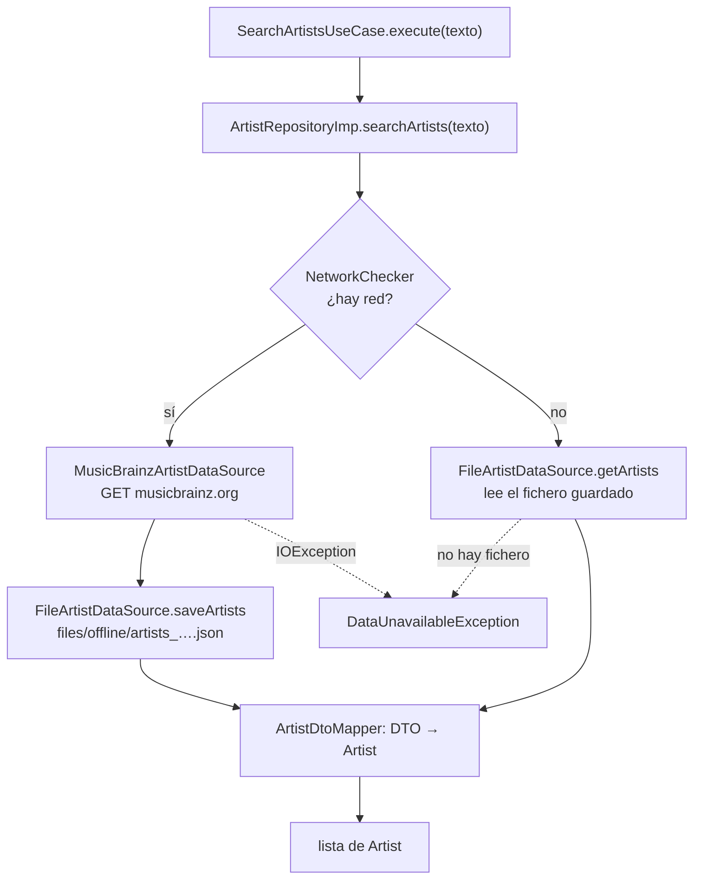
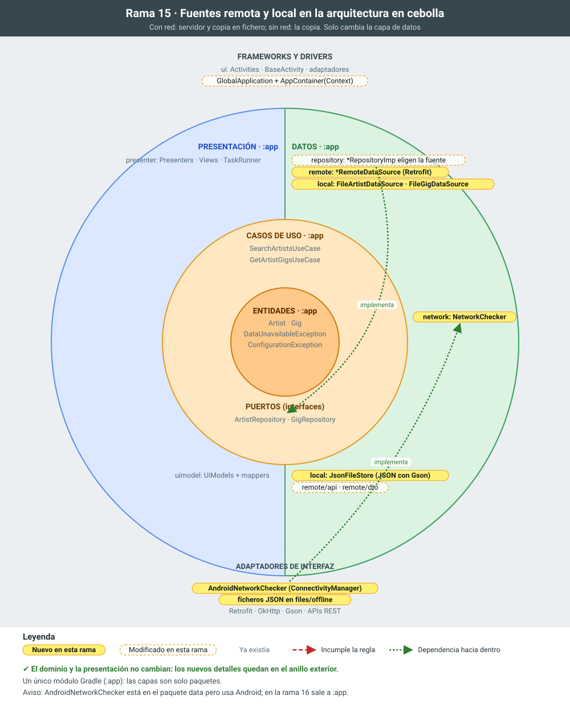

# 15 · Fuentes de datos remota y local: la app funciona sin red

**Objetivo:** que la aplicación funcione sin conexión. Si hay red, el repositorio consulta los servidores y guarda los resultados en ficheros locales. Si no hay red, responde con lo guardado.

## Motivación

En la rama 14 cada repositorio hablaba directamente con una API. Con una única fuente, el repositorio parecía un intermediario innecesario: ¿por qué no llamar a Retrofit desde el caso de uso?

Esta rama responde a esa pregunta con un caso real. La app debe funcionar también sin conexión, así que hay **dos fuentes de datos** y alguien tiene que decidir cuál usar. Esa es la responsabilidad del repositorio:

- **El dominio no cambia.** `SearchArtistsUseCase` sigue pidiendo "artistas para este texto" y no sabe si vienen de MusicBrainz o de un fichero.
- **La presentación no cambia.** Ni las actividades ni los presenters se tocan.
- **Todo el cambio queda dentro de `data`** y del `AppContainer`. Es la promesa de la Clean Architecture: los detalles (de dónde salen los datos) se cambian sin tocar el centro.

## Estructura resultante

```
app/  (es.udc.psi.cleanarchv2.app)
├── GlobalApplication            crea el AppContainer con el Context de la aplicación
├── di/AppContainer              crea las fuentes, el NetworkChecker y los repositorios
├── presentation/                (sin cambios)
├── domain/                      (sin cambios)
└── data/
    ├── repository/              ArtistRepositoryImp, GigRepositoryImp: eligen la fuente
    ├── remote/                  fuentes remotas
    │   ├── ArtistRemoteDataSource, GigRemoteDataSource         (interfaces)
    │   ├── MusicBrainzArtistDataSource, SetListFmGigDataSource (Retrofit)
    │   ├── MissingApiKeyException
    │   ├── api/                 MusicBrainzAPI, SetListFmAPI, ApiFactory, interceptores
    │   └── dto/                 DTOs del JSON + mappers DTO → entidad
    ├── local/                   fuentes locales
    │   ├── ArtistLocalDataSource, GigLocalDataSource           (interfaces)
    │   ├── FileArtistDataSource, FileGigDataSource             (ficheros JSON)
    │   └── JsonFileStore        guarda y lee objetos como JSON, un fichero por clave
    └── network/
        ├── NetworkChecker       (interfaz) ¿hay red?
        └── AndroidNetworkChecker  implementación con ConnectivityManager
```

## Cómo decide el repositorio



Los bolos siguen el mismo esquema con `GigRepositoryImp`, `SetListFmGigDataSource` y `FileGigDataSource` (un fichero por artista).

## Qué cambia y por qué

1. **Fuentes remotas en `data.remote`.**
   - `ArtistRemoteDataSource` y `GigRemoteDataSource` son interfaces. Sus implementaciones con Retrofit son lo que antes estaba dentro de los repositorios: la consulta Lucene de MusicBrainz, el 404 de setlist.fm y la comprobación de la API key.
   - Retrofit, los interceptores y los DTOs pasan a `remote/api` y `remote/dto`, porque son detalles de esta fuente.
   - *Motivación:* el repositorio deja de saber *cómo* se habla con un servidor y solo decide *a quién* preguntar.
   - Las fuentes trabajan con DTOs e `IOException`, detalles de la capa de datos. El repositorio los traduce a entidades y a excepciones del dominio.
2. **Comprobación de red: `NetworkChecker` y `AndroidNetworkChecker`.**
   - *Motivación:* saber si hay red depende de Android (`ConnectivityManager`, permiso `ACCESS_NETWORK_STATE`). El repositorio solo ve una interfaz con un método `isNetworkAvailable()`.
   - Así sigue siendo Java puro y en los tests se simula "con red" o "sin red" con una lambda: `() -> true`.
3. **Fuentes locales en `data.local`.**
   - `JsonFileStore` guarda cualquier objeto como JSON con Gson. Usa un fichero por clave, con un nombre legible más el *hash* de la clave para que dos búsquedas distintas nunca compartan fichero.
   - `FileArtistDataSource` guarda cada búsqueda. La clave va en minúsculas, porque MusicBrainz no distingue mayúsculas.
   - `FileGigDataSource` guarda los bolos de cada artista.
   - *Motivación:* el fichero guarda **los mismos DTOs que devolvió el servidor**: es una copia de la respuesta. Así se reutiliza el mismo mapper DTO → entidad para las dos fuentes, y el formato del fichero no depende de las entidades del dominio.
   - Los ficheros van en `getFilesDir()/offline` y no en `getCacheDir()`, porque Android puede vaciar la caché cuando le falta espacio.
4. **Los repositorios eligen la fuente.**
   - Con red, piden los datos al servidor y guardan una copia. Si guardar la copia falla, devuelven igualmente los datos: la búsqueda ha funcionado, solo que no estará disponible sin conexión.
   - Sin red, leen la copia local. Si no hay ninguna, lanzan `DataUnavailableException` y la vista muestra el mensaje de error de siempre.
   - El `AppContainer` recibe ahora el `Context` para crear el `AndroidNetworkChecker` y el directorio de los ficheros.
   - Tests nuevos:
     - `ArtistRepositoryImpTest` y `GigRepositoryImpTest`, con fuentes falsas en memoria y una red simulada;
     - `JsonFileStoreTest` y `FileGigDataSourceTest`, con una carpeta temporal de JUnit.

## Para explicar

- **El repositorio es el que tiene la política** ("con red, servidor y copia; sin red, copia"). Cambiarla es tocar una sola clase. Por ejemplo, para leer la copia local también cuando el servidor falla (el 503 de MusicBrainz es frecuente) o para hacer "primero la caché y luego la red".
- **Las fuentes no saben unas de otras.** La remota no sabe que existe una copia local, y la local no sabe de dónde salieron los datos.
- **Los tests documentan el comportamiento**: `withoutNetwork_readsTheSavedResultWithoutAskingTheServer` falla si el repositorio llama al servidor sin red.
- **La regla de dependencias sigue cumpliéndose**, pero aún por disciplina. `data.network.AndroidNetworkChecker` es la única clase de `data` que importa Android. En la rama 16, al convertir `data` en una librería Java pura, tendrá que salir de ese módulo.

## Cómo probarlo

1. Tests: `./gradlew testDebugUnitTest`.
2. En el emulador, con red, busca un artista y abre sus bolos. En *Device Explorer* aparecen los ficheros en `/data/data/es.udc.psi.cleanarchv2/files/offline/`.
3. Quita la red: desactiva el Wi‑Fi y los datos móviles (o usa `adb shell svc wifi disable` y `adb shell svc data disable`).
   - Repite la misma búsqueda y abre el mismo artista: los datos salen de los ficheros y Logcat no muestra ninguna petición de OkHttp.
   - Abre otro artista que no hayas consultado antes: aparece el mensaje de error.

## La rama en la cebolla



En amarillo, lo que añade la rama; con borde discontinuo, lo que modifica; en gris, lo que ya existía. Las flechas rojas numeradas son dependencias que apuntan hacia fuera e incumplen la regla de dependencias; las verdes, dependencias correctas hacia dentro.

## Commits de esta rama

1. `75dbf5e` Fuentes remotas en data.remote: el repositorio delega en ArtistRemoteDataSource y GigRemoteDataSource
1. `9158c8d` Comprobación de red: NetworkChecker y su implementación con ConnectivityManager
1. `744b008` Fuentes locales en data.local: artistas y bolos en ficheros JSON, con sus tests
1. `bc7a728` Los repositorios eligen la fuente: con red, servidor y copia local; sin red, la copia local
