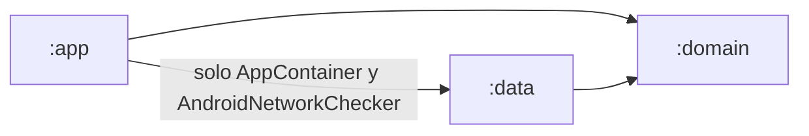
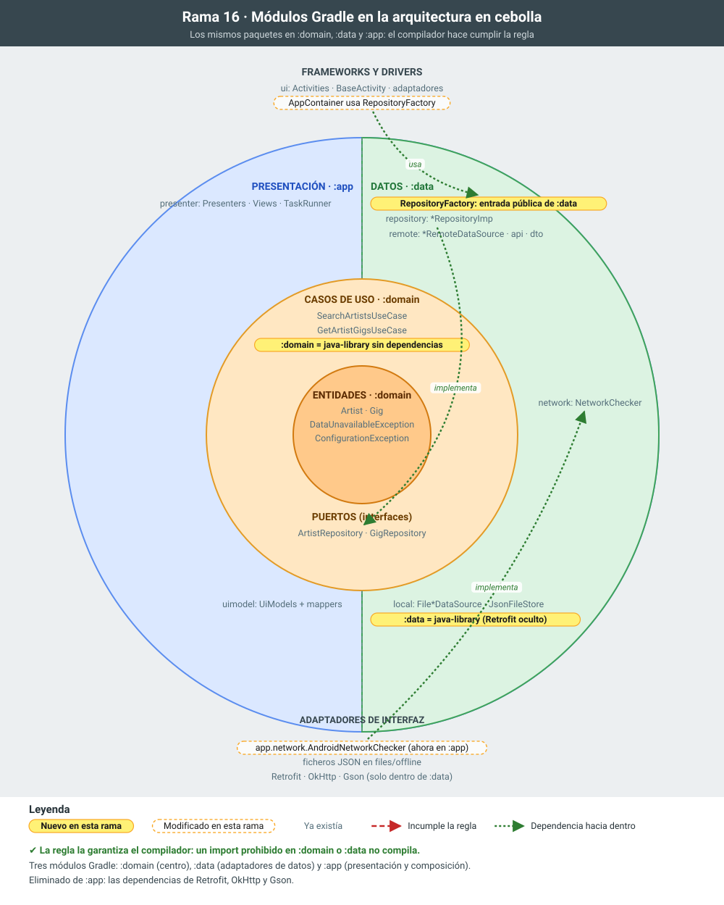

# 16 · De paquetes a módulos: el compilador hace cumplir la arquitectura

**Objetivo:** separar las capas en tres módulos Gradle (`:domain`, `:data` y `:app`) para que romper la regla de dependencias sea un **error de compilación** y no solo una mala práctica.

El esquema en capas concéntricas de esta rama está en [arquitectura_cebolla.md](arquitectura_cebolla.md).

## Motivación

En las ramas 14 y 15 la arquitectura es correcta, pero solo por disciplina. Todo vive en el módulo `:app`, así que nada impide:

- escribir `import retrofit2.Call;` o `import android.content.Context;` en una clase de `domain`;
- que un presenter cree directamente un `MusicBrainzArtistDataSource`;
- que `data` use una clase de `presentation`.

Ya pasó en las ramas 12 y 13, donde el dominio importaba Retrofit. En un proyecto real, con muchas personas y prisas, estas dependencias acaban apareciendo.

Un módulo Gradle solo ve las dependencias que declara en su `build.gradle.kts`. Si `:domain` no declara ninguna, **el compilador** impide que el dominio conozca Android, Retrofit o los datos. La regla deja de depender de que alguien revise los `import`.

Hay otras ventajas:

- **Compilación incremental:** cambiar una Activity no recompila el dominio.
- **Tests más rápidos:** los de `:domain` y `:data` se ejecutan en la JVM sin el plugin de Android.
- **Responsabilidades visibles** en la propia estructura del proyecto.

## Estructura resultante

```
settings.gradle.kts         include(":app", ":domain", ":data")
domain/   (java-library, sin dependencias)          es.udc.psi.cleanarchv2.domain
├── model/  repository/  usecase/  exception/
data/     (java-library: :domain + Retrofit/OkHttp/Gson)   es.udc.psi.cleanarchv2.data
├── RepositoryFactory       única entrada pública del módulo
├── repository/             ArtistRepositoryImp, GigRepositoryImp
├── remote/                 fuentes remotas, api/ y dto/
├── local/                  fuentes locales y JsonFileStore
└── network/                NetworkChecker (interfaz)
app/      (Android: :domain + :data)                es.udc.psi.cleanarchv2.app
├── GlobalApplication
├── di/AppContainer         usa RepositoryFactory
├── network/                AndroidNetworkChecker (ConnectivityManager)
└── presentation/           ui/, presenter/, uimodel/  (sin cambios)
```



## Qué cambia y por qué

1. **`:domain`: módulo Java puro.**
   - Los paquetes `app.domain.*` pasan tal cual al módulo `domain`, con sus tests. Solo cambia el paquete (`es.udc.psi.cleanarchv2.domain`), porque ya no forman parte de la app.
   - Es una `java-library` y no un módulo Android: no tiene acceso al SDK de Android, y sus tests se ejecutan con JUnit en la JVM.
2. **`:data`: librería Java con los repositorios y las fuentes remota y local.**
   - El paquete `app.data.*` pasa al módulo `data`, que declara Retrofit, OkHttp y Gson como `implementation` y `:domain` como `api`. Los repositorios exponen tipos del dominio a quien use `:data`.
   - **`AndroidNetworkChecker` no puede entrar en `:data`**, porque usa `ConnectivityManager` y una `java-library` no compila código Android. Se queda en `:app` (`app.network`) e implementa la interfaz `NetworkChecker` de `:data`.
   - Es el mismo patrón de puertos y adaptadores: `:data` dice qué necesita saber ("¿hay red?") y el anillo exterior le da la implementación concreta.
   - En la rama 15 era la única clase de `data` que importaba Android. Los módulos lo han hecho visible.
3. **`RepositoryFactory`: única entrada pública a `:data`.**
   - *Motivación:* como Retrofit es `implementation` en `:data`, `:app` no lo ve, y así debe ser. El `AppContainer` ya no puede construir `ApiFactory` ni las fuentes una a una.
   - `RepositoryFactory` las monta dentro del módulo y devuelve solo los puertos del dominio (`ArtistRepository` y `GigRepository`). Recibe la configuración: User-Agent, API key, logging, directorio de los ficheros y `NetworkChecker`.
   - `:app` elimina sus dependencias de Retrofit, OkHttp y Gson.
4. **Esquema en cebolla** actualizado con las fuentes local y remota y el `NetworkChecker`.

## Para explicar

- **Haz la prueba:** añade `import retrofit2.Call;` en `SearchArtistsUseCase`, o `import android.util.Log;` en `ArtistRepositoryImp`. En la rama 15 compilaba; ahora no.
- **`api` frente a `implementation` en Gradle.** `:data` expone `:domain` con `api` porque sus clases públicas usan entidades y puertos. Esconde Retrofit con `implementation` porque es un detalle interno.
- **Mismos paquetes, otro contenedor.** El código apenas cambia respecto a la rama 15: la arquitectura ya estaba bien. Los módulos no la crean, la **protegen**.
- **Siguiente paso en una app grande:** modularizar también por funcionalidad (`:feature:artists`, `:feature:gigs`, `:core:data`…). Es lo que hace el ejemplo *Now in Android* de Google.

## Cómo probarlo

- Tests: `./gradlew :domain:test :data:test testDebugUnitTest`.
- Comprobación de la regla de dependencias: los comandos `grep` de [arquitectura_cebolla.md](arquitectura_cebolla.md).
- La app funciona igual que en la rama 15, con y sin red.

## La rama en la cebolla



En amarillo, lo que añade la rama; con borde discontinuo, lo que modifica; en gris, lo que ya existía. Las flechas rojas numeradas son dependencias que apuntan hacia fuera e incumplen la regla de dependencias; las verdes, dependencias correctas hacia dentro.

## Commits de esta rama

1. `a049b4a` :domain: el dominio pasa a un módulo Java puro
1. `5225408` :data: repositorios y fuentes remota y local pasan a un módulo Java; AndroidNetworkChecker se queda en :app
1. `c2c7ac3` RepositoryFactory: única entrada pública a :data; :app deja de depender de Retrofit
1. `69ab42c` Esquema en capas concéntricas (cebolla) de la arquitectura
