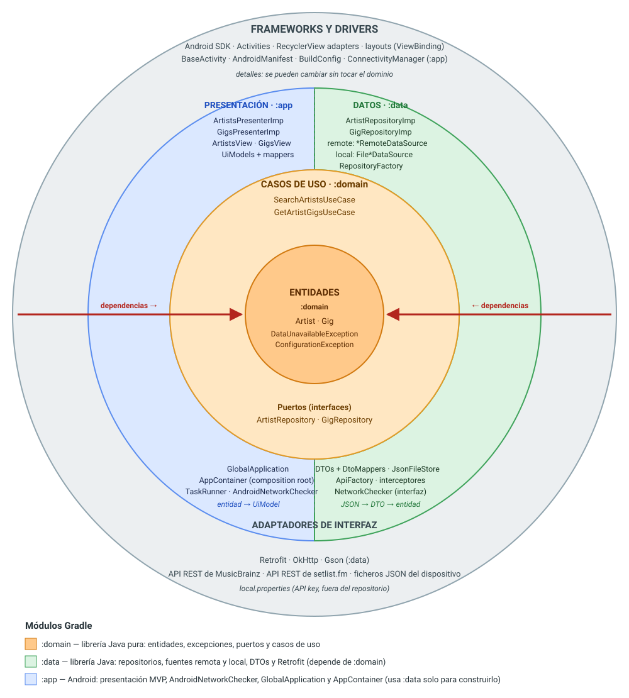
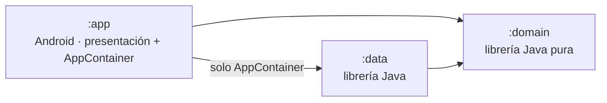
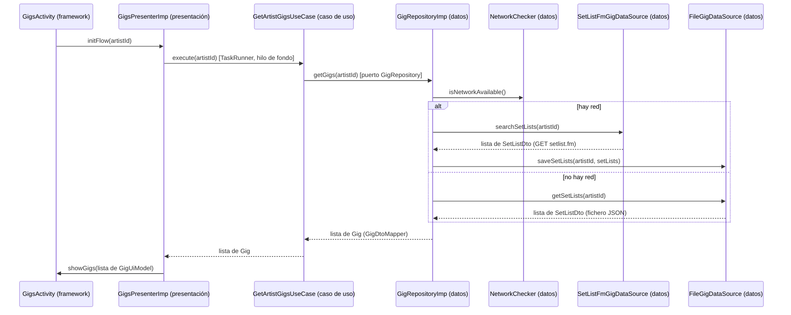

# Arquitectura en cebolla de PSiCleanArch

Esquema en capas concéntricas ("cebolla") de la rama `feature/16_modules`, la versión final: Clean Architecture con fuentes remota y local y un módulo Gradle por capa. Cada anillo es una capa y cada color es un módulo Gradle.



## La regla de la cebolla

1. **Las dependencias solo apuntan hacia dentro.** Un anillo puede usar lo que hay en los anillos interiores, nunca lo de los exteriores.
2. **El centro no conoce nada del exterior.** Entidades y casos de uso no saben si la app es Android, si los datos vienen de Retrofit o de un fichero, ni si la UI usa MVP.
3. **Los datos cruzan los anillos traducidos.** JSON → DTO → entidad → UiModel. Cada anillo solo maneja sus propios modelos.
4. **Las capas exteriores se pueden sustituir.** La rama 15 lo demostró: añadir una copia local para funcionar sin red no tocó ni el dominio ni la presentación.

## Anillo a anillo

| Anillo | Módulo | Paquete | Elementos | Qué hace |
|---|---|---|---|---|
| **1 · Entidades** (centro) | `:domain` | `domain.model`, `domain.exception` | `Artist`, `Gig`, `DataUnavailableException`, `ConfigurationException` | Conceptos y errores del negocio, en Java puro |
| **2 · Casos de uso** | `:domain` | `domain.usecase` | `SearchArtistsUseCase`, `GetArtistGigsUseCase` | Una clase por acción de la aplicación, con sus reglas (texto vacío, artista sin id…) |
| **2 · Puertos** | `:domain` | `domain.repository` | `ArtistRepository`, `GigRepository` | Interfaces que el dominio **define** y el exterior **implementa** (inversión de dependencias) |
| **3 · Adaptadores: datos** | `:data` | `data.repository`, `data.remote`, `data.local`, `data.network`, `data` | `*RepositoryImp`, `*RemoteDataSource` (MusicBrainz, setlist.fm), `*LocalDataSource` (ficheros JSON), `JsonFileStore`, `NetworkChecker`, DTOs y `*DtoMapper`, `ApiFactory`, interceptores, `RepositoryFactory` | Implementar los puertos, elegir la fuente según haya red, traducir JSON/HTTP a entidades y `IOException` a excepciones del dominio |
| **3 · Adaptadores: presentación** | `:app` | `app.presentation.presenter`, `app.presentation.uimodel` | `*PresenterImp`, `*View`, `TaskRunner`, `*UiModel` y `*UiModelMapper` | Convertir eventos de la UI en casos de uso y resultados en estados de la vista |
| **4 · Frameworks y drivers** | `:app` / `:data` | `app.presentation.ui`, `app.network`, `app`, `app.di` | Activities, `BaseActivity`, adaptadores de RecyclerView, layouts y ViewBinding, `AndroidNetworkChecker` (`ConnectivityManager`), `GlobalApplication` y `AppContainer`, `BuildConfig`; Retrofit, OkHttp, Gson; las APIs y los ficheros del dispositivo | Detalles técnicos que se pueden cambiar |

`GlobalApplication` y `AppContainer` forman el *composition root*, el componente *Main* de la Clean Architecture. Están en el anillo exterior y son lo único que conoce todas las implementaciones.

## Los módulos Gradle hacen cumplir la regla



- `:domain` es una `java-library` **sin dependencias**. Si alguien escribe `import retrofit2...` o `import android...` en el dominio, **no compila**.
- `:data` depende solo de `:domain` y de Retrofit/OkHttp/Gson, que declara como `implementation`. No sabe que existe Android ni la presentación:
  - recibe la configuración (User-Agent, API key, logging, directorio de los ficheros) como parámetros;
  - define la interfaz `NetworkChecker`, y su implementación con `ConnectivityManager` está en `:app`.
- `:app` depende de `:domain` para la presentación. De `:data` solo usa `RepositoryFactory` y `NetworkChecker`, y únicamente desde el `AppContainer` y `AndroidNetworkChecker`. Retrofit ni siquiera está en su *classpath* de compilación.

## Flujo de "ver los bolos de un artista" a través de la cebolla



Errores:
- Si falla la red o no hay copia guardada, las fuentes lanzan `IOException` y `GigRepositoryImp` la traduce a `DataUnavailableException`.
- Si falta la API key, la traduce a `ConfigurationException`.

El presenter solo conoce las excepciones del dominio.

## Cómo comprobar que se cumple

```bash
# :domain solo importa java.* y su propio paquete
grep -rh "^import" domain/src/main | grep -v "cleanarchv2\.domain" | sort -u

# :data no importa nada de Android ni de la presentación
grep -rh "^import" data/src/main | grep -E "android|cleanarchv2\.app"

# en :app, solo el AppContainer y AndroidNetworkChecker conocen :data
grep -rl "cleanarchv2\.data\." app/src/main
```

## De la rama 14 a la 16

| Rama | Organización | Quién garantiza la regla de dependencias |
|---|---|---|
| 14 | Un módulo; paquetes `presentation`, `domain` y `data` | La disciplina del programador |
| 15 | Igual, con `data.remote`, `data.local` y `data.network` | La disciplina del programador |
| 16 | Módulos `:domain`, `:data` y `:app` con los mismos paquetes | El compilador |
