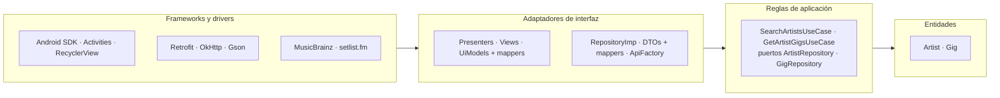
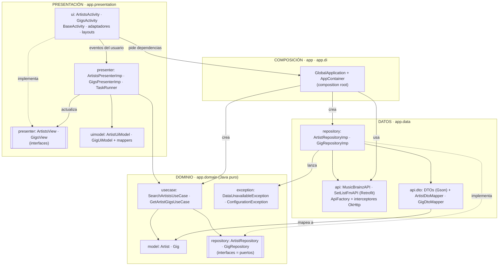
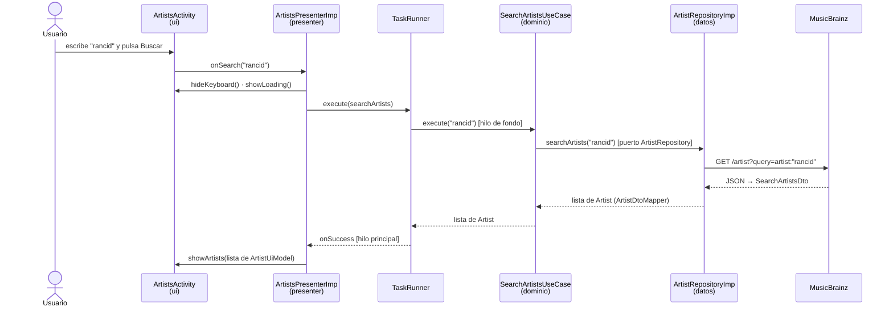

# PSiCleanArch y la Clean Architecture

> Este esquema describe la rama [`feature/14_clean_architecture`](14_clean_architecture.md). La rama [`feature/15_remote_local`](15_remote_local.md) añade las fuentes de datos remota y local, y la rama [`feature/16_modules`](16_modules.md) separa las capas en módulos Gradle. El esquema en cebolla de esta última está en [arquitectura_cebolla.md](arquitectura_cebolla.md).

Este documento explica cómo encajan los paquetes y clases de la aplicación en la **Clean Architecture**, qué ramas de la fase Clean cumplen sus pautas y por qué se ha elegido esta organización.

> Los diagramas están en Mermaid. Se ven directamente en GitLab y en la vista previa Markdown de Android Studio.

## 1. La idea en una frase

El código se organiza en capas concéntricas y **las dependencias solo apuntan hacia dentro**, hacia el dominio. El dominio contiene las reglas de negocio y no conoce Android, Retrofit, Gson ni la UI. Las capas externas dependen de él, nunca al revés (*Dependency Rule*).

## 2. Mapa de la aplicación (rama `feature/14_clean_architecture`)

El dominio no tiene flechas que salgan de él. La capa de datos apunta al dominio porque **implementa** sus interfaces: es la inversión de dependencias, el patrón *Ports & Adapters*.

## 3. Cada elemento en su capa

| Capa Clean | Paquete | Elementos | Responsabilidad | Depende de |
|---|---|---|---|---|
| **Entidades** | `domain.model`, `domain.exception` | `Artist`, `Gig`, `DataUnavailableException`, `ConfigurationException` | Datos y errores del negocio, sin anotaciones ni frameworks | nada |
| **Casos de uso** | `domain.usecase` | `SearchArtistsUseCase`, `GetArtistGigsUseCase` | Una clase por acción del usuario, con sus reglas (no buscar con texto vacío…) | entidades y puertos |
| **Puertos** | `domain.repository` | `ArtistRepository`, `GigRepository` | Lo que el dominio necesita del exterior, definido por el propio dominio | entidades |
| **Adaptadores de datos** | `data.repository`, `data.api`, `data.api.dto` | `*RepositoryImp`, `*API`, `ApiFactory`, interceptores, DTOs y `*DtoMapper` | Implementar los puertos: hablar con MusicBrainz y setlist.fm, traducir JSON a entidades e `IOException` a excepciones del dominio | dominio, Retrofit/OkHttp/Gson |
| **Adaptadores de presentación** | `presentation.presenter`, `presentation.uimodel` | `*PresenterImp`, `*View`, `TaskRunner`, `*UiModel`, `*UiModelMapper` | Convertir eventos en casos de uso y resultados en estados de la vista | dominio |
| **Frameworks (UI)** | `presentation.ui` | `*Activity`, `BaseActivity`, adaptadores, layouts | Pintar y capturar eventos, sin lógica | presenters, ViewBinding |
| **Composición** | `app`, `di` | `GlobalApplication`, `AppContainer` | Único lugar que conoce las implementaciones y las une | todas las capas |

## 4. Flujo de una búsqueda a través de las capas

Cada frontera traduce los datos: **JSON → DTO → entidad → UiModel**. Así ninguna capa ve los modelos de otra.

## 5. Cumplimiento por rama (fase Clean)

Comprobado con los `import` de cada clase en cada rama.

| Rama | Regla de dependencias | Observaciones |
|---|---|---|
| `10_MVP` | ✘ (aún no hay capas) | Separa vista y presenter, pero el presenter usa Retrofit y los modelos JSON |
| `11_MVVP` | ✘ (aún no hay capas) | Añade modelos de vista; el presenter sigue accediendo a la red |
| `12_services` | ✘ **incumple** | Crea el dominio, pero `ArtistServiceImp` y `GigServiceImp` (en `domain`) importan Retrofit, OkHttp, los DTOs de `data` y `BuildConfig` |
| `13_datasources` | ✘ **incumple a medias** | `ArtistServiceImp` ya es puro; `GigServiceImp` todavía importa Retrofit, OkHttp, DTOs y `BuildConfig` |
| `14_clean_architecture` | ✔ | El dominio solo importa clases del dominio y de `java.*`; datos y presentación dependen del dominio |

Las ramas 12 y 13 son pasos intermedios a propósito: primero aparece el dominio y después se le quita el acceso a datos. La rama 14 completa el camino.

## 6. Por qué esta organización

Hay tres formas habituales de organizar una app Android con Clean Architecture:

| | Paquetes por capa en un módulo (rama 14) | Módulos `:domain`, `:data`, `:app` (rama 16) | `app/presentation` + `app/framework`, `usecases`, `domain`, `data` |
|---|---|---|---|
| Quién hace cumplir la regla de dependencias | La disciplina | El compilador | El compilador |
| Ceremonia | Baja | Media | Alta |
| Facilidad para explicarla | La más fácil | Media | La más difícil |

El proyecto las recorre en ese orden:

- **Rama 14:** la arquitectura se entiende con carpetas.
- **Rama 15:** se demuestra para qué sirve el repositorio, coordinando dos fuentes de datos.
- **Rama 16:** se extraen las capas a módulos para que el compilador impida romper la regla.

## 7. Qué queda por hacer

| Limitación de la rama 14 | Rama que la resuelve |
|---|---|
| El repositorio solo tiene una fuente (la API), así que parece un intermediario innecesario | **15:** fuentes `data.remote` y `data.local`; el repositorio elige según haya red o no y guarda los resultados en ficheros |
| La regla de dependencias solo se cumple por disciplina: nada impide importar Retrofit en `domain` | **16:** módulos `:domain` (Java puro), `:data` y `:app`; un `import` prohibido deja de compilar |
