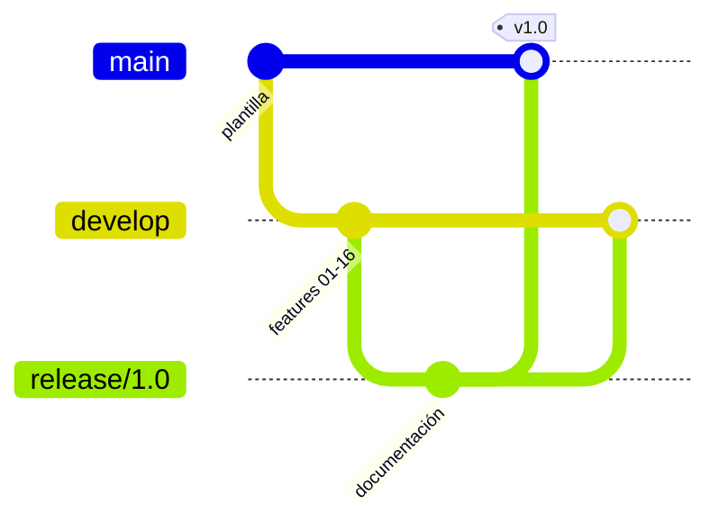

# Release 1.0

**Objetivo:** publicar la primera versión de la aplicación siguiendo gitflow: llevar a `master` el código de `develop` con las features 01 a 16.

## Motivación

En gitflow, `master` solo contiene versiones publicadas. Hasta ahora todas las features se habían fusionado en `develop` y `master` seguía en el punto de partida: la plantilla que genera Android Studio. Esta release completa el ciclo de gitflow, el único paso que faltaba en el repositorio.

## Cómo se hace una release en gitflow



En el diagrama, `main` es la rama `master` del repositorio (es el nombre que usa Mermaid).

1. **Se crea `release/1.0` desde `develop`.** A partir de ese momento las features nuevas pueden seguir entrando en `develop` sin afectar a la versión.
2. **En la rama de release solo se hacen ajustes de publicación:** número de versión, documentación y correcciones de última hora. Nunca funcionalidades nuevas. Aquí la versión ya era `versionName = "1.0"`, así que solo se actualiza la documentación.
3. **Se fusiona en `master` con `--no-ff` y se etiqueta `v1.0`.** La etiqueta marca exactamente qué código se publicó.
4. **Se fusiona también en `develop`**, para que los ajustes hechos en la release no se pierdan.

```bash
git checkout -b release/1.0 develop
# ... ajustes de publicación ...
git checkout master
git merge --no-ff release/1.0
git tag -a v1.0 -m "Versión 1.0"
git checkout develop
git merge --no-ff release/1.0
```

## Contenido de la versión 1.0

- **Features 01 a 09 (monolítica):** búsqueda de artistas en MusicBrainz y sus conciertos en setlist.fm, con Retrofit, OkHttp, interceptores y ViewBinding.
- **Features 10 a 16 (Clean):** MVP y UiModels, casos de uso, repositorios y puertos, inyección con `AppContainer`, funcionamiento sin red con fuentes remota y local, y módulos `:domain`, `:data` y `:app`.

## Cómo probarlo

- `git checkout v1.0` deja el código exactamente como se publicó.
- `master` y la etiqueta `v1.0` apuntan al mismo commit, y su código es el mismo que el de `develop` en ese momento.
